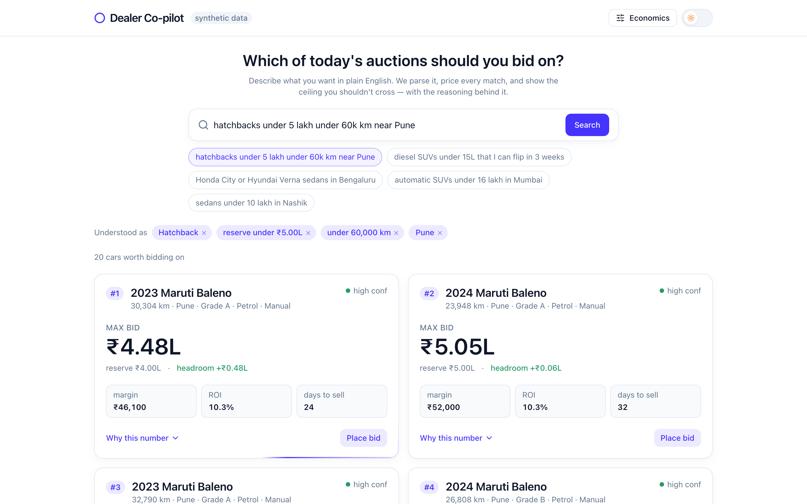

<div align="center">

# 🚗 Dealer Sourcing Co-pilot

**A pricing-confidence tool for used-car dealers bidding on auction inventory.**
Describe what you want in plain English → it finds matching cars, computes the
**maximum bid** you shouldn't cross for each, and shows the full reasoning.

[**▶ Live demo**](https://dealer-sourcing-copilot.vercel.app) · [How it works](HOW_IT_WORKS.md) · [API](https://dealer-copilot-api.onrender.com/health)

`FastAPI` · `scikit-learn` · `React + TypeScript` · `Tailwind` · `Groq LLM` · `Render` · `Vercel`

</div>

<p align="center">
  
</p>

> **Synthetic data — no CARS24 data was used or accessed.** Every car, price and
> sale is produced by a seeded simulator. This is not affiliated with CARS24; it
> borrows the rebranded *design language* only. The metrics below measure the
> model on synthetic data — not a claim about real-world accuracy.

---

## The problem

Used-car auction platforms run **thousands of auctions a day**. A dealer has
seconds of attention per car and no price intelligence, so they bid on gut feel —
or don't bid at all. **This isn't a browsing problem; it's a pricing-confidence
problem.** The hard part isn't showing cars, it's telling a dealer *the most they
can pay and still make their margin* — and being honest when the data can't
support an answer.

## The core design principle

> **The LLM parses language. A model computes the number. Rules make the
> decision. The dealer confirms it.**

The language model only ever emits search **filters** — never a price, valuation,
or bid. That boundary is enforced **twice** in code: a schema that forbids extra
fields, and an assertion that rejects any price-shaped key in the raw model
output. A bad LLM parse can only produce wrong *filters* (which the dealer sees
as removable chips) — **never a wrong bid.** This is the whole point of the
product, and it's what makes an AI pricing tool trustworthy.

---

## Architecture

```
          Dealer types a sentence
                   │
      ┌────────────▼────────────┐
      │ intent.py               │   LLM → strict JSON filters
      │  (the ONLY LLM call)    │   retry once → keyword fallback
      └────────────┬────────────┘
                   │  filters (never a price)
      ┌────────────▼────────────┐
      │ search.py               │   deterministic filter over inventory
      └────────────┬────────────┘
                   │  candidate cars
      ┌────────────▼────────────┐
      │ pricing.py              │   ML models → predicted retail + days-to-sell
      │                         │   cost formula → max_bid, margin, headroom
      │                         │   comparables count → confidence (or refuse)
      └────────────┬────────────┘
                   │  priced cars
      ┌────────────▼────────────┐
      │ ranking.py              │   drop no-headroom / low-confidence
      │                         │   blended score 0.5 margin · 0.3 speed · 0.2 conf
      └────────────┬────────────┘
                   │
         JSON + trace_id  →  React UI (cards · why-panel · economics sliders)
```

Each module has one job and a strict boundary: `intent.py` is the **only** thing
that calls an LLM; `pricing.py` is the **only** thing that produces a number.
They never touch each other. → Full walkthrough in **[HOW_IT_WORKS.md](HOW_IT_WORKS.md)**.

---

## How the number is built

The ML predicts; a transparent formula decides:

```
max bid = predicted retail − refurb − holding − fees − your target margin
```

| Cost | How it's computed |
|---|---|
| Refurb | predicted retail × grade % (A 1.4%, B 3.2%, C 6.5%) |
| Holding | predicted days-to-sell × ₹120/day |
| Fees | predicted retail × 1.5% |
| Target margin | predicted retail × 9% (dealer-configurable) |

**Headroom** = max bid − auction reserve (positive = worth bidding). Every number
on a card opens into this exact breakdown, and it always ties to the max bid.

### Two ML models (gradient boosting, trained on 10k synthetic sales)

| Model | Held-out accuracy (n = 2,000) |
|---|---|
| Retail price | **MAE ₹19,121 · 3.88% MAPE** |
| Days to sell | **MAE 4.6 days** |

### It refuses when unsure

Before pricing, it counts genuinely comparable past sales (same model, ±1 year,
±30% km). Fewer than 10 → **no price is shown at all**, just the observed range.
~6% of cars land here and are honestly refused rather than guessed.

---

## Engineering decisions (why it holds up)

This was built to solve the problem *well*, not just to demo:

- **Auditable by design.** Every recommendation returns a `trace_id`;
  `GET /trace/{id}` replays the whole chain (raw query → LLM output → filters →
  candidates → scoring → result). A pricing system you can't audit is one nobody
  deploys.
- **The AI is replaceable.** Swap the model/provider or drop to keyword parsing —
  the economics don't change, because language understanding and price
  computation are separate subsystems. The app works **with no API key** via a
  deterministic fallback.
- **Stateless economics.** The dealer's assumptions travel in the request body,
  so changing a slider is a re-request, not server state — the panel is instant
  and the backend stays horizontally scalable (no sticky sessions).
- **Startup precompute for speed.** All predictions + comparables are computed
  **once at boot** and cached, turning each request into a filter + cheap
  arithmetic — **~1,000× faster per request**, so it runs comfortably on a
  free-tier box and would scale linearly with inventory.
- **Honest failure.** Cold-start retries on the client, a keep-alive worker, and
  a confidence gate that declines rather than hallucinating.

---

## Tech stack

| Layer | Choice |
|---|---|
| **Backend** | Python · FastAPI · pydantic v2 |
| **ML** | scikit-learn (Gradient Boosting) · pandas · numpy |
| **LLM** | Groq (`openai/gpt-oss-120b`), OpenAI-compatible, JSON mode |
| **Frontend** | React · TypeScript · Vite · Tailwind (token-based) · motion |
| **Hosting** | API on Render · UI on Vercel · keep-alive via GitHub Actions |
| **Data** | Parquet files + joblib models (committed, synthetic, seeded) |

---

## Run locally

**Backend** (needs [uv](https://docs.astral.sh/uv/)):

```bash
cd api
uv sync
cp .env.example .env            # optional: add GROQ_API_KEY (works without it)
uv run uvicorn app.main:app --reload --port 8000
# data/ and models/ are committed; regenerate only if you want to:
#   uv run python -m app.generate_data && uv run python -m app.train
uv run python evals/run_evals.py   # field accuracy + price-leakage check
uv run pytest -q
```

**Frontend**:

```bash
cd ui
npm install
cp .env.example .env.local      # VITE_API_URL=http://localhost:8000
npm run dev
```

---

## Project structure

```
dealer-sourcing-copilot/
├─ api/                      FastAPI backend
│  ├─ app/
│  │  ├─ main.py             routes only (no logic)
│  │  ├─ intent.py           LLM → filters (the only LLM call)
│  │  ├─ search.py           filters → candidate cars
│  │  ├─ pricing.py          models + cost formula → the number
│  │  ├─ ranking.py          blended score
│  │  ├─ schemas.py          pydantic contracts (price-leakage guard)
│  │  ├─ generate_data.py    seeded synthetic data generator
│  │  └─ train.py            trains both models + writes metrics.json
│  ├─ data/                  inventory.parquet · sold.parquet
│  ├─ models/                price.joblib · dts.joblib · metrics.json
│  ├─ evals/                 30 regression queries + runner
│  └─ tests/                 pricing + intent tests
├─ ui/                       React + Vite frontend
│  └─ src/{components, lib, hooks}
├─ render.yaml               API deploy blueprint
├─ .github/workflows/        keep-alive pinger
├─ README.md · HOW_IT_WORKS.md
```

---

## Evals & honesty

`evals/run_evals.py` runs **30 hand-authored regression queries**: **100% field
accuracy (360/360)** and **0/30 price leakage**. These guard the parser and the
price boundary — they're correctness checks I wrote, **not** a held-out benchmark,
and all reported numbers are on synthetic data (they measure the model, not the
market).

## What I'd do next

- **Per-dealer personalisation** — learn each dealer's real turn-time and realised
  margins, instead of one global days-to-sell model.
- **Photo-based grade inference** — infer the A/B/C condition grade from listing
  photos rather than taking it as a given field.
- **Live auction integration** — real inventory and reserves behind the same
  (still dealer-confirmed) bid path.
